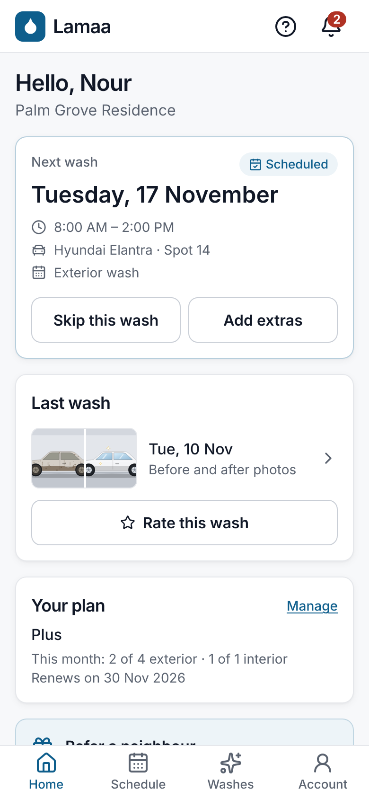
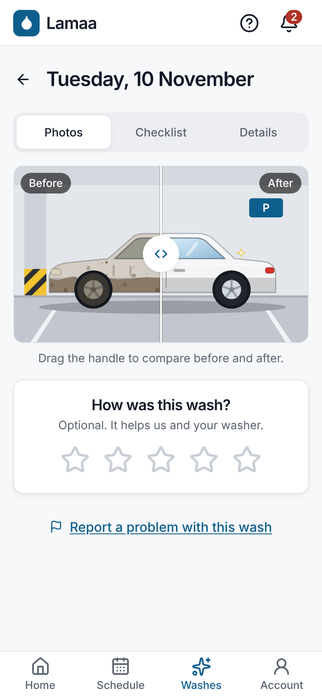
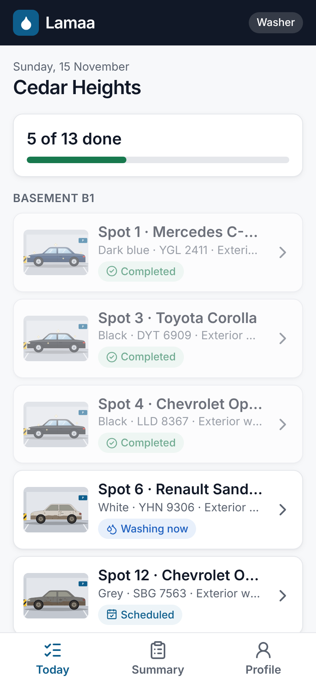
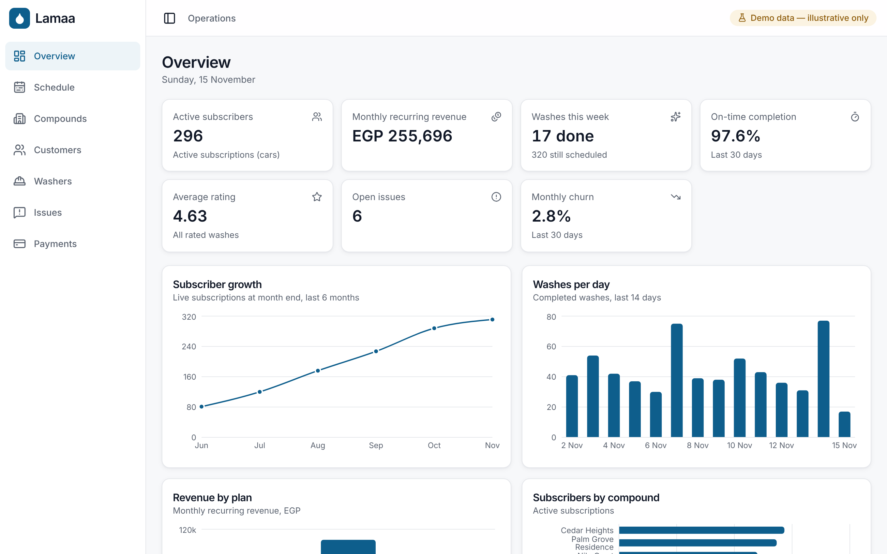
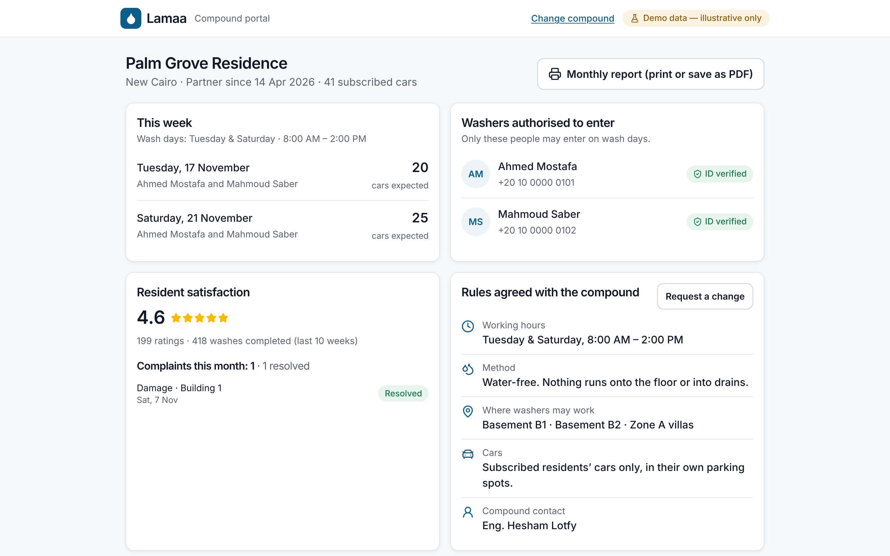
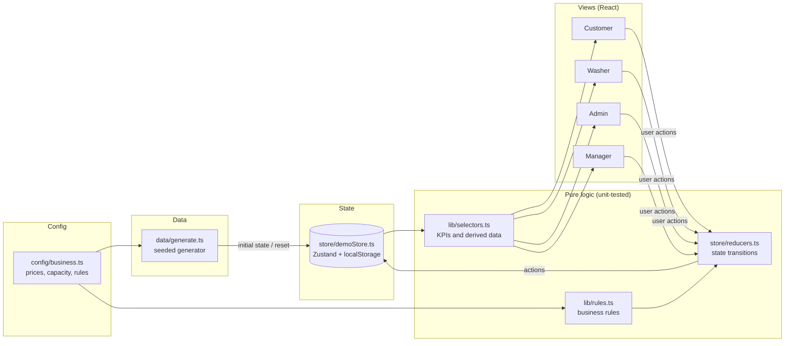

# Lamaa — compound car-wash subscription demo

A clickable, **frontend-only** demo of a car-wash subscription for residential compounds:
residents subscribe once, and their car is washed every week in its own parking spot on the
compound's fixed wash days.

It exists to be shown to people: on a phone to compound residents in interviews, and on a
laptop to compound managers and an investor.

> **Everything in this demo is fictional.** The compounds, residents, washers, prices and
> every number on the dashboards are generated for illustration. Nothing here is a real
> partnership or a real result. No payment is processed and no data leaves the browser.
> "Lamaa" is a placeholder name.

## The four views

| Customer app                                         | Wash photos                                                           | Washer app                                         |
| ---------------------------------------------------- | --------------------------------------------------------------------- | -------------------------------------------------- |
|  |  |  |

**Operations dashboard**



**Compound manager portal**



| View                    | For                                                          | Open at            |
| ----------------------- | ------------------------------------------------------------ | ------------------ |
| Customer app            | Residents: next wash, live status, photos, plan              | `/#/customer/home` |
| Washer app              | Washers: today's route and a step-by-step wash flow          | `/#/washer/today`  |
| Operations dashboard    | The operations team: KPIs, schedule board, issues, payments  | `/#/admin`         |
| Compound manager portal | Compound management: who enters, when, resident satisfaction | `/#/manager`       |

## Run it

Requires Node.js 22 or newer.

```bash
npm install
```

```bash
npm run dev
```

Then open the address Vite prints (usually `http://localhost:5173`).

| Script                  | What it does                                         |
| ----------------------- | ---------------------------------------------------- |
| `npm run dev`           | Development server with hot reload                   |
| `npm run build`         | Type-check, then build the static site into `dist/`  |
| `npm run preview`       | Serve the built site locally                         |
| `npm run typecheck`     | TypeScript, strict mode                              |
| `npm run lint`          | ESLint                                               |
| `npm run format`        | Prettier                                             |
| `npm run test`          | Unit and component tests (Vitest)                    |
| `npm run test:coverage` | The same, with a coverage report                     |
| `npm run test:e2e`      | End-to-end test of the customer journey (Playwright) |

The end-to-end test needs a browser once: `npx playwright install chromium`.

## Running a demo or an interview

Start at the launcher (`/#/`).

- **Start as a new customer** opens the onboarding flow from scratch and records, on this
  device only, how long each screen took (see _Interview sessions_ below).
- The four cards open each view with ready-made data. The customer view is logged in as
  **Nour Hassan**, a resident with ten weeks of wash history.

### The demo toolbar

The small **Demo** button (bottom-left) opens the presenter's controls:

| Control            | What it does                                                                                                                                                                 |
| ------------------ | ---------------------------------------------------------------------------------------------------------------------------------------------------------------------------- |
| View as            | Switch between Customer, Washer, Admin and Compound manager                                                                                                                  |
| Customer persona   | Nour Hassan, a customer created in this session, or a new customer                                                                                                           |
| Simulate next step | Moves the customer's wash one step: scheduled → washer on site → washing → done with photos. Every washer working today moves one step too, so the dashboards change as well |
| Presentation mode  | Hides every demo control. Bring them back with **Shift+D**, or a long-press on the logo                                                                                      |
| Reset demo         | Restores the original data                                                                                                                                                   |

The toolbar hides itself while an interview is being recorded and whenever a sheet is open.

### Interview sessions

Sessions recorded by "Start as a new customer" are listed at `/#/admin/interviews` (linked
from the demo toolbar): total time, slowest step, back presses, and the plan, day and
payment method chosen. **Export JSON** downloads all of it. The data is stored in this
browser's `localStorage` and is never sent anywhere.

### Sharing

`/#/share` shows a QR code of the demo's address, for opening it on someone's phone.

## Change the business assumptions

Every price and rule lives in **[`src/config/business.ts`](src/config/business.ts)**:

- plan names, prices and what each includes
- add-on prices
- `WASHES_PER_WASHER_PER_DAY` (capacity of a service day = washers × this number)
- family discount, skip cutoff hour, pause limits, service window

Change a value, then use **Reset demo** so the mock data is regenerated. The number of
customers per compound adapts to the capacity you set.

Other things you may want to change:

| What                                              | Where                                              |
| ------------------------------------------------- | -------------------------------------------------- |
| Brand name and tagline                            | `src/config/brand.ts`                              |
| Compounds, their wash days and washers            | `src/data/compounds.ts` (keep the names fictional) |
| Colours and type                                  | the `@theme` block in `src/index.css`              |
| Real before/after photos instead of illustrations | `src/config/photos.ts`                             |

## Architecture

There is no backend. The app is a static site; all data is generated in the browser from a
fixed seed and kept in `localStorage`.



How to read it:

- **`config/`** holds the assumptions. Nothing else contains a price or a limit.
- **`data/generate.ts`** builds the whole world (10 compounds, 9 washers, ~290 customers,
  10 weeks of washes) from a seed. Same day + same seed = identical data, so a reset always
  returns to the same state. Dates are relative to today so the demo always looks current.
- **`lib/rules.ts`** answers business questions as pure functions: can this wash still be
  skipped, how many spots are left, what does a second car cost, where does a rained-off
  wash move to.
- **`store/reducers.ts`** applies an action to the data and returns what changed. Because
  all four views read the same store, completing a wash in the washer view immediately
  shows photos to the customer and moves the admin numbers.
- **`lib/selectors.ts`** computes everything the dashboards show. No KPI is hard-coded.

```
src/
  app/          router and the four layouts
  config/       business.ts, brand.ts, photos.ts, shared labels
  data/         seeded generator and its name/car/compound lists
  types/        domain model
  store/        Zustand store and pure reducers
  lib/          rules, selectors, formatting, calendar file, session recorder
  components/   ui/ (buttons, sheets, table…) and app/ (plan card, car illustration…)
  features/     launcher, customer, washer, admin, manager, styleguide, share
tests/
  unit/         rules, selectors, reducers, generator, components
  e2e/          the customer journey, in a real browser
```

`/#/styleguide` shows every component and all 56 car illustration variants.

## Engineering decisions

The full list, one line each, is in **[DECISIONS.md](DECISIONS.md)**. The main ones:

- **Frontend only.** The demo's job is to test whether people understand and want the
  service, not to run it. No backend means no hosting cost, no accounts, no personal data,
  and a link that always works in an interview. The business logic is already separated
  from the UI, so it can move behind an API later.
- **Zustand for state.** One small store shared by four views, with built-in persistence.
  Redux would add ceremony the demo does not need; React context would re-render too much
  with ~4,000 washes in memory.
- **Pure rules and reducers.** Everything that encodes a business decision is a function of
  its inputs, with "now" passed in. That makes rules such as the 8 PM skip cutoff testable
  without mocking the clock, and `rules.ts` is covered 100%.
- **HashRouter.** GitHub Pages serves static files and cannot redirect deep links to
  `index.html`. With hash routes (`/#/admin`) a reload always works, with no server config.
- **GitHub Pages via GitHub Actions.** Free, and every push to `main` is type-checked,
  linted, tested (unit and end-to-end) and only then deployed.
- **Generated SVG "photos".** No real photos exist yet, and stock photos would misrepresent
  the service. The illustrations are seeded per wash so each wash keeps its own picture.
- **Honest by design.** Demo data is labelled on every dashboard, the card form is
  read-only so nobody types real card details, compounds are fictional, and cancelling is
  two plain steps.

## Deployment

`.github/workflows/ci.yml` checks every push and pull request, and deploys `main` to GitHub
Pages.

One-time setup in the GitHub repository: **Settings → Pages → Build and deployment →
Source: GitHub Actions**. After the next push to `main`, the site is at
`https://<your-username>.github.io/<repository-name>/`.

The build uses a relative base path, so it works under any repository name.

## Known limits

- Stored demo data is regenerated when the calendar day changes, because all dates are
  relative to today. A customer created yesterday is gone today; interview recordings are
  kept.
- English only, no dark mode, no real notifications: see section 15 of `PLAN.md`.
- Lighthouse has not been run against the deployed site yet. Run it on the customer home
  after the first deploy to confirm the targets in `PLAN.md` section 12.
